> **中文汉化版** · 上游：[tt-a1i/archify](https://github.com/tt-a1i/archify) · 原文件：`archify/references/explainer-authoring.md` · License: Apache-2.0
> 翻译日期：2026-11-13 · 同步状态：上游 HEAD（2026-11-13 快照）· AI 辅助翻译 + 人工校对
> 术语以 [GLOSSARY.md](../../../../../GLOSSARY.md) 为准；代码块、命令与 frontmatter 字段名保持原文。本文件为翻译作品，非上游官方中文版。

# 解说页（explainer）编写指南

解说页（explainer）把一个带结论和结构的回答（解释、比较、决策、诊断、评审或计划）变成一页。页面以结论开头，把推理展示成面板：图、表、步骤和短文字。何时制作、以及可选模式，见 Skill 的 “Choose the artifact” 一节。画系统的请求使用原生图类型。

本指南就是完整的草稿语言。直接按它写草稿。

## 草稿

写一个 Markdown 文件 `candidate.archify.md`。标题后的第一段就是直接结论。紧随其后的扁平列表给出至多四条理由。每个 `##` 标题开启一个面板。

```md
# Why does the first HTTPS visit take an extra round trip? {#tls-first-visit}

The browser and server must agree on keys before any request is sent: **one extra round trip** with TLS 1.3.

- The browser sends its key share in the first message, so one round trip is enough.[](source:rfc8446)
- The server replies with its key share, then its certificate, already encrypted.
- A returning browser can resume and send data immediately.

@answer scope="TLS 1.3 · first visit · no proxy"
@meta locale=en
@source rfc8446 title="RFC 8446: TLS 1.3" url=https://www.rfc-editor.org/rfc/rfc8446

## What is exchanged before the first request? {#handshake}

@sequence id=handshake-flow title="TLS 1.3 full handshake"
| actor browser | Browser | frontend |
| actor server | Server | backend |
| browser | server | ClientHello + key share |
| server | browser | ServerHello + key share | return |
| server | browser | Certificate + Finished (encrypted) | return |
| browser | server | Finished + GET / | emphasis |
| server | browser | 200 OK | return |

@steps id=handshake-steps
| hello | ClientHello | Offers cipher suites and a key share. | handshake-flow | browser |
| reply | ServerHello | Picks a suite and sends its key share; the certificate follows encrypted. | handshake-flow | server |
| done | Finished | Both sides confirm the keys; the request rides along. | handshake-flow | browser |

## How does TLS 1.3 compare with 1.2? {#versions}

| Criterion | TLS 1.2 | TLS 1.3 |
| --- | --- | --- |
| Round trips before data | Two {caution:Slower} | One {good:Faster} |
| Resumed connection | One | Zero {good:0-RTT} |
```

用 [交付](#delivery) 一节中的命令交付。

### 保持草稿有效的规则

- ID 在整个文档内唯一：面板、块、图和步骤共用一个命名空间。只有当步骤、链接或补丁要指向某个块时才给它 `id`；callout、facts 和列表一律省略。图按内容命名（`handshake-flow`），不按所在面板命名（`handshake`）。
- 散文是纯文本。文件路径、glob、`<placeholders>`、运算符和代码都用反引号包住：散文里裸写的 `<`、`>` 或 `*` 会被当成 HTML 或强调而报错。行内代码按字面显示。
- 指令行是竖线行，每行一条，单元数与文档规定一致：`| first | second |`。单元内的字面竖线写成 `\|`。空行或下一个 `##` / `@` 行结束这组行。
- 指令参数是 `key=value`；带空格的值用双引号加 JSON 转义。
- 原生图用下面的紧凑行来画。内联 JSON 规格只留给例外情况。
- 嵌套列表、原始 HTML 和其他 Markdown 扩展会失败，并给出定位诊断：指明行号、组件和修复示例。

## 按信息的形态选择形式

一张图取代描述它的那段话。回答涉及关系、流程、随时间的交互、层级、历史或数据模型时，就画图。典型页面有结论、一张图、一到两个表格或步骤列表。

| 信息形态 | 形式 |
| --- | --- |
| 各方之间按顺序的消息：协议、请求路径 | `@sequence` |
| 带步骤和分支的流程：分诊、上线、审批 | `@workflow` |
| 系统的组成部分及其连接方式 | `@architecture` |
| 层级结构：目录、模块、分类体系 | `@tree` |
| 随时间发生的事件：事故、发布 | `@timeline` |
| 带字段和关系的实体 | `@erd` |
| 多个准则上比较的选项 | 带 `{good:…}`、`{caution:…}`、`{bad:…}` 单元的 Markdown 表格 |
| 有顺序的动作、检查或阶段 | `@steps` |
| 读者必须做或核实的事 | 任务列表，`- [ ] item` |
| 警告、待解问题或关键注意事项 | `@callout` |
| 少量带标签的事实 | `@facts` |
| 跨条目或跨时间比较的数字、整体占比、2×2 优先级、数量流动 | ```` ```mermaid ```` 图表围栏 |
| 一个数字对照一个上限 | `@metric` |
| 仓库里存在的代码 | `@code` |
| 对代码的更改 | `@diff` 或 ```` ```diff ```` 围栏 |
| 尚不存在的命令、配置或代码 | 普通围栏 |

走读一张图的步骤放在该图的面板里：页面把它们排在图旁边，每一步点亮它对应的部分，读者可以逐步查看。每个步骤用它指向的节点标签作标题，让文字与图一眼对上；细节列写明在该处做什么。

小回答配小页面：结论加一两个面板。原理、诊断或清单类问题通常需要三到五个。

## 写作

为会照页面行动、并可能核实的读者写作。使用用户的语言。

- 结论最先被读；之后的每个面板都在支持、限定或应用它。没有可支持的就停笔。
- 覆盖读者按回答行动所需的内容：结论背后的机制、如何核实、以及它不成立的情形。细心的读者接下来会问的那个问题，给它一个面板、一行表格或 scope 里的一行；没有它读者就会搞错的事实不是可选项。
- 每个面板只回答一个问题，每句话只做一个断言。表格或图已经展示的断言不再复述；文字补充它的理由或例外。
- 同一事物在标题、面板、图标签和表头中只用一个术语，并优先用读者自己的叫法。页面会把文中出现的名称链接到带该标签的节点，读者可以在图里指到它。
- 结果连同证据一起给：数字带单位、文件位置、来源。值未知或为估计时，在 scope 里说明。
- 读者无法自行核实的断言都要引 `@source`：协议细节、阈值、基准数字、API 行为。没有来源的经验法则要么标明是经验法则，要么不写。
- 交付前重算每个派生数字，并展示一遍算式：“1000 个请求中 990 个在 80 ms → P99 = 80 ms；11 个慢 → P99 = 600 ms。”表格的合计要对得上。
- 动作写成祈使句，触发条件放前面：“如果迁移报告 schema 不匹配，先回滚再重试。”
- 读者需要行动或核实时，以清单面板收尾：`- [ ] item`，每项一个具体检查。读者在页面上勾选。

英文：短句（约 25 词以内）、常用词（use、before、to、because）、主动语态并点名主语。

中文：短句，每句不超过约 50 字；动词直接用（检查、决定，而不是进行检查、做出决定）；一句话里的“的”不超过两个；数字后写清边界（超过 3 次、不超过 1 秒）；用具体结果代替套话（赋能、全方位、至关重要）。

## 紧凑原生图

写 `@<type> id=<diagram-id> title="..."` 加竖线行。每张都编译成完整的原生 Archify 图，带原生校验和布局，并可在页面上打开完整 Viewer。一个文档最多四张原生图。

任何节点、参与者或实体行都可以以 `source:<id>` 单元格结尾，指名一个已声明的 `@source`；悬停该节点会显示来源，仓库文件还会显示其固定行号，代码图因此兼作代码导览。

节点与参与者类型：`frontend`、`backend`、`database`、`cloud`、`security`、`messagebus`、`external`（默认 `backend`）。边与消息变体：`default`、`emphasis`、`security`、`dashed`；时序图还接受 `return`。ID 以字母开头，使用字母、数字、`-` 和 `_`。

**`@sequence`**：先声明参与者，再按顺序写消息。

```md
@sequence id=cache-read title="Cache miss"
| actor api | Order API | backend |
| actor redis | Redis | database |
| api | redis | GET order:42 |
| redis | api | nil | return |
```

参与者行：`actor <id> | label | type`。消息行：`from | to | label | variant?`，其中 `from` 和 `to` 是参与者 ID 或标签。`phase | label` 行在其后的消息上方开一条带标签的分带，直到下一个 phase：`phase | TCP handshake (1 RTT)`。

**`@workflow`** 与 **`@architecture`**：先节点，后边。布局沿边从左到右排布，从没有入边的节点开始。

```md
@workflow id=triage title="Latency triage"
| alert | Alert fires | external |
| split | Check percentiles | backend |
| trace | Compare slow traces | backend |
| fix | Fix the cause | backend |
| alert > split | |
| split > trace | tail only |
| trace > fix | cause found | emphasis |
```

节点行：`id | label | type?`。边行：`from > to | label? | variant?`。节点随标签变宽，所以节点标签用几个词点名该步骤（中文约 10 字以内，英文约 4 词以内），细节交给 `@steps`。边标签控制在一两个词。以 `?` 结尾的节点标签画成判定；它的出边用答案作标签（`yes`、`no`、`是`、`否`）。

把流程的步骤分组为阶段：先声明 `lane <id> | label` 行，再把每个 workflow 节点的阶段写成第四个单元。至多六个节点画成一行，阶段标签在其上方；更长的流程按阶段换行，每阶段一行。

```md
@workflow id=p99-flow title="P99 triage"
| lane confirm | Confirm the symptom |
| lane locate | Locate the cause |
| alert | P99 up, mean flat | external | confirm |
| window | Align window and percentiles | backend | confirm |
| sample | Sample slow requests | backend | locate |
| fix | Fix and verify | backend | locate |
| alert > window | |
| window > sample | tail grew |
| sample > fix | cause | emphasis |
```

架构图允许十二列。互相通信的组件用 `@architecture`，读者要跟随的步骤用 `@workflow`。

**`@tree`**：每个节点一行，`id | label | parent`；根的父是 `-`。

```md
@tree id=package-layout title="Package layout"
| root | archify | - |
| bin | bin | root |
| explainer | explainer | root |
```

**`@timeline`**：可选的 lane 行，然后是事件，`id | ISO time with offset | title | lane? | kind?`。kind 取值：`default`、`change`、`alert`、`action`、`recovery`。

```md
@timeline id=incident title="Checkout incident"
| lane ops | Operations |
| deploy | 2026-10-01T10:00:00+08:00 | Deploy v2 | ops | change |
| alarm | 2026-10-01T10:12:00+08:00 | Error rate alarm | ops | alert |
```

速写时间线会被标为 illustrative（示意），并以 UTC 显示时间。

**`@erd`**：先实体，再字段，最后关系。

```md
@erd id=order-model title="Orders"
| entity user | User |
| entity order | Order |
| user.id | bigint | pk |
| order.id | bigint | pk |
| order.user_id | bigint | fk | user.id |
| order > user | many:one | placed by |
```

字段行：`entity.field | type | keys? | references?`，键 `pk`、`fk`、`uk` 逗号分隔。关系行：`from > to | one:one|one:many|many:one|many:many | label?`。

其余原生类型（`dataflow`、`lifecycle`、`class`、`waterfall`）以及需要显式几何的图，使用同目录下的规格文件：`@diagram dataflow source=events.dataflow.json`，用 Skill 的原生编写工作流来写。

## 图表

一个 ```` ```mermaid ```` 围栏用数字画图表：`pie`、`xychart-beta`（柱状和折线）、`quadrantChart`、`sankey-beta`、`radar-beta` 或 `venn-beta`。页面把它渲染成页面主题下的静态 SVG。可选的 `title="..."` 成为图注。

````md

```mermaid title="Latency before and after the release (ms)"
xychart-beta
  x-axis ["Mean", "P50", "P99"]
  y-axis "ms" 0 --> 700
  bar "Before" [80, 75, 80]
  bar "After" [88, 76, 600]
```

````

给每个系列命名（`bar "Before" [...]`），图表才有图例。柱子显示数值，饼图图例显示每个值及其占比。排名条目或较长的类别名用 `xychart-beta horizontal`。当数字本身就是重点时（比如一个值跳升而其他持平、前后对比、占比），画成图，让对比一眼可见；图下的表格只补每个数字需要的那几个字。对比放进一张图，比如前后对比的均值、P50 和 P99。

数字在草稿旁边的 CSV 或 JSON 文件里时，直接图表化该文件，不要复制数值：`@chart type=bar|line|pie data=latency.csv x=day y=p50,p99 unit=ms title="..."`。`x` 指名标签列，`y` 每个系列一个值列（饼图取第一列）。CSV 需要表头行；JSON 是对象数组。文件在交付时读取并冻结，至多 60 行（饼图 12 行）。空值是错误而不是零：填上它，或去掉该行并在图注里说明。

图表像文字一样声明数字来源：实测、来自来源、估计或示意，写在图注或 scope 里。含空格或非 ASCII 文本的标签一律加引号。流程图、时序图、类图、ER 图、状态图、时间线和思维导图类 Mermaid 改用上面的原生速写，由 Archify 校验并支持读者探索。

## 指令参考

| 指令 | 头部参数 | 行 |
| --- | --- | --- |
| `@answer` | `scope="..."` | 无 |
| `@meta` | `locale`（`en`、`zh-CN`、`zh-TW`、`es`、`ko`、`ar`）、`quality_profile`、`style`（`clean`、`editorial`、`product`、`swiss`；读者可切换）、`repo_url`、`repo_revision` | 无 |
| `@source <id>` | `title`、`url`，或带 `lines=start:end` 的 `path` | 无 |
| `@steps` | `id` | `id | title | detail? | diagram-id? | node? | from~to? | edge-ids?`（node 与 route 互斥） |
| `@callout` | `id`、`level=note|warning|open-question`、`title` | 每行一个单元；各行拼接成段落 |
| `@facts` | `id` | `label | value` |
| `@metric` | `id`、`label`、`value`、`limit`、`unit`、`note`、`typical=true` | 无；`value` 或 `limit` 必填 |
| `@comparison` | `id`、`columns="A,B"`、`label` | `criterion | cell per option` |
| `@prose` | `id`、`text` | 每行一个单元 |
| `@list` | `id`、`ordered=true` | 每行一个单元 |
| `@code` | `id`、`source=<source-id>`、`language` | 无 |
| `@diff` | `id`、`caption` | 后随一个 ```` ```diff ```` 围栏 |
| `@image` | `id`、`path`、`alt`、`caption` | 无 |
| `@chart` | `type`（`bar`、`line`、`pie`）、`data`（`.csv` 或 `.json`）、`x`、`y`、`unit`、`title`、`id` | 无 |
| `@<diagram type>` | `id`、`title`、`changes` | 上面的紧凑行 |
| `@diagram <type>` | `id`、`source`、`title` | 无 |

普通段落、扁平列表和 Markdown 表格不需要指令。表格的第一个表头单元给行列命名；比较单元可以以 `{good:Label}`、`{caution:Label}` 或 `{bad:Label}` 结尾，行标签可以带 `{#row-id}`。只标注决定比较结果的单元，通常每行一到两个；每个单元都带徽章读起来就是噪音。

普通围栏（```` ```bash title="Run the tests" ````）是带复制按钮的字面代码片段。`@code` 从来源的 Git 提交和行范围取真实摘录；不接受手写的代码文本。`@image` 内嵌一个受控的本地 PNG、JPEG、GIF 或 WebP。

## 行内链接与来源

支持 `**bold**`、行内代码和安全的 HTTP(S) 链接。`[Redis](node:cache-read.redis)` 和 `[path](route:cache-read.api~redis)` 会在目标存在时打开原生 Viewer。`[details](block:next)` 在页内跳转。

`[reference text](source:docs)` 渲染该文本并跟随一个编号上标；`[](source:docs)` 只渲染上标。编号按首次出现顺序；未引用的来源按声明顺序排在后面。页脚列出标题及其 URL 或仓库位置。

```md
@source router title="Request handler" path=src/router.js lines=10:30
@code source=router language=js
```

传 `--repo-root /path/to/repository` 以取代码摘录。有了它，每个带行范围的仓库来源引用，读者悬停时还会显示其固定行号；无法核实的来源保持普通引用。工具解析 origin 和 HEAD，或接受 `@meta repo_url=... repo_revision=<full-commit>`。提交、路径和行范围必须存在；工作区编辑不能替代已提交的字节。

`[5 ms](typical:Description of the value)` 变成静态脚注，打印时同样有效。

## 面板与布局

面板标题优先用具体的问题。`{#id}` 给出用于链接和面板替换的稳定 ID；`{#id span=7}` 固定 1–12 列的宽度。不要写 span：页面会测量每个面板并规划版面，保持源顺序且结论在左上，给每张图足够宽度让标签可读，并避免表格和代码被裁切。无 JavaScript、低于 1100 px 和打印时使用静态宽度。

## 交付

```sh
node archify/bin/archify.mjs finalize explainer candidate.archify.md answer.html --json
```

通过后用两三行回复：先结论，然后一个带描述性标题的 Markdown 链接指向页面。不要罗列关卡。当用户主动要这个页面、且上下文中没有 `[archify explainer: ...]` 规则行时，以 Skill 的 Output 一节的一行模式提议收尾。

草稿用了 `@code` 就加上 `--repo-root <path>`。Finalize 负责校验、原子交付并检查 HTML；它不启动浏览器，其回执把浏览器关卡记为未运行。失败会指明行、组件、原因和修复示例；修好草稿后重跑，输出到同一路径。

写作警告执行 [写作](#writing) 一节的规则：超过 50 个中文单位或 28 个英文单词的句子、超过四句或 120 个单位的段落、连用的“的”、轻动词、套话、开头语和结束语、无边界数量、数字后接“以上/以下/以内”、有常用等价词的长英文词、scope 之外的“示例”“未实测”"illustrative"等限定词、大段加粗的结论、超过 50 个单位的 scope。每条警告都指明命中的文本和修法；修法不损原意时照改。`--writing warn|strict|off` 设置严重级别。

## 面板替换

```sh
node archify/bin/archify.mjs patch explainer answer.html next replacement.md revised.html --json
```

替换文件包含一个 `##` 面板，带同一个稳定 ID；未触及的内容和冻结资产保持不变。改动共享来源、结论或全文档结构时，对完整草稿重跑 finalize。
