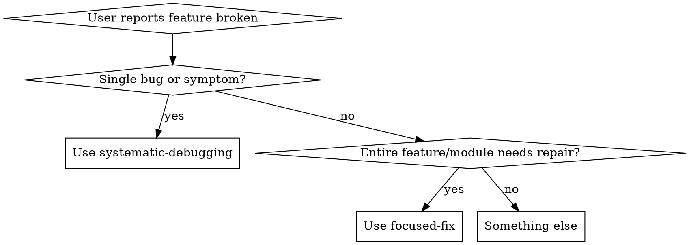
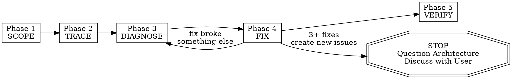

> **中文汉化版** · 上游：[alirezarezvani/claude-skills](https://github.com/alirezarezvani/claude-skills) · 原文件：`engineering/skills/focused-fix/SKILL.md` · License: MIT
> 翻译日期：2026-11-12 · 同步状态：上游 HEAD（2026-11-12 快照）· AI 辅助翻译 + 人工校对
> 术语以 [GLOSSARY.md](../../../../GLOSSARY.md) 为准；代码块、命令与 frontmatter 字段名保持原文。本文件为翻译作品，非上游官方中文版。

# 聚焦修复：功能深度修复

## 何时使用

当用户要求修复、调试某个具体的功能/模块/区域，或让它正常工作时启用。关键触发语：
- "让 X 跑起来"
- "修复 Y 功能"
- "Z 模块坏了"
- "聚焦 [area]"
- "这个功能需要正常工作"

这不适用于单个缺陷的快速修复（那种情况请用 systematic-debugging）。它适用于整个功能或模块需要系统性修复的场景：追踪每一处依赖、查阅日志、检查测试、梳理完整的依赖图。





## 铁律


```
NO FIXES WITHOUT COMPLETING SCOPE → TRACE → DIAGNOSE FIRST
```


如果还没完成阶段 3，就不能提出修复方案。没有例外。

**违背这些阶段的字面要求，就是违背聚焦修复的初衷。**

## 流程：严格按顺序执行以下 5 个阶段





### 阶段 1：SCOPE，划定功能边界

在动手改任何代码之前，先弄清该功能的完整范围。

1. 如果还不明确，询问用户：「我该聚焦哪个功能/文件夹？」
2. 确定该功能对应的主要文件夹/文件
3. 梳理该文件夹中的每个文件：逐一阅读，弄清各自的用途
4. 建立一份功能清单：


```
FEATURE SCOPE:
  Primary path: src/features/auth/
  Entry points: [files that are imported by other parts of the app]
  Internal files: [files only used within this feature]
  Total files: N
  Total lines: N
```


### 阶段 2：TRACE，梳理所有依赖（内部与外部）

追踪该功能与代码库其余部分之间的每一处关联。

**INBOUND（该功能导入了什么）：**
1. 针对该功能文件夹内每个文件中的每条 import 语句：
   - 追踪到它的来源
   - 确认源文件存在
   - 确认被导入的实体（函数、类型、组件）存在且已导出
   - 检查类型/签名是否与功能预期一致
2. 检查是否存在：
   - 用到的环境变量（grep 搜索 process.env、import.meta.env、os.environ 等）
   - 引用的配置文件
   - 使用的数据库模型/schema
   - 调用的 API 端点
   - 导入的第三方包

**OUTBOUND（哪些内容导入了该功能）：**
1. 在整个代码库中搜索从该功能文件夹导入的语句
2. 针对每个使用方：
   - 确认它们导入的实体确实存在
   - 检查它们使用的 API/接口是否正确
   - 记录是否有使用方仍在使用已废弃的模式

输出格式：

```
DEPENDENCY MAP:
  Inbound (this feature depends on):
    src/lib/db.ts → used in auth/repository.ts (getUserById, createUser)
    src/lib/jwt.ts → used in auth/service.ts (signToken, verifyToken)
    @prisma/client → used in auth/repository.ts
    process.env.JWT_SECRET → used in auth/service.ts
    process.env.DATABASE_URL → used via prisma

  Outbound (depends on this feature):
    src/app/api/login/route.ts → imports { login } from auth/service
    src/app/api/register/route.ts → imports { register } from auth/service
    src/middleware.ts → imports { verifyToken } from auth/service

  Env vars required: JWT_SECRET, DATABASE_URL
  Config files: prisma/schema.prisma (User model)
```


### 阶段 3：DIAGNOSE，找出每一个问题

系统地排查问题。执行以下全部检查：

**代码质量：**
- [ ] 每条 import 都能解析到真实的文件/导出
- [ ] 功能内部不存在循环依赖
- [ ] 跨边界的类型保持一致（接口处不使用 `any`）
- [ ] 所有异步操作都有错误处理
- [ ] 不存在标示已知问题的 TODO/FIXME/HACK 注释

**运行时：**
- [ ] 所有必需的环境变量都已设置（检查 .env）
- [ ] 数据库迁移已更新到最新（如适用）
- [ ] API 端点返回预期的数据结构
- [ ] 不存在本应可配置却写死的值

**测试：**
- [ ] 运行与该功能相关的全部测试：通过搜索从该功能文件夹导入的语句来找到它们
- [ ] 记录每一次失败及完整的错误输出
- [ ] 检查测试覆盖率：是否存在未被测试覆盖的代码路径？

**日志与错误：**
- [ ] 搜索任何日志文件、错误报告或 Sentry 式的错误追踪
- [ ] 用 git log 检查该功能近期的改动：`git log --oneline -20 -- <feature-path>`
- [ ] 检查近期是否有 commit 可能破坏了某些东西：`git log --oneline -5 --all -- <files that this feature depends on>`

**配置：**
- [ ] 确认该功能依赖的所有配置文件都有效
- [ ] 检查开发与生产环境配置之间的不一致
- [ ] 确认第三方服务的凭证有效（若可测试）

**根因确认：**
对发现的每个严重问题，在加入修复清单前先确认根本原因：
- 明确陈述：「我认为 X 是根本原因，因为 Y」
- 沿数据/控制流反向追溯来验证，不要轻信表层症状
- 如果问题横跨多个组件，在每个边界加上诊断日志，定位是哪一层出错
- 对于复杂缺陷，先做一次根因调查再继续：稳定复现故障、读完完整的错误与堆栈信息、查看近期改动（`git log`、`git diff`），并且一次只提出一个假设，用尽可能小的改动去验证它。在假设通过验证之前，不要把该缺陷加入修复清单。

**风险标注：**
为每个问题标注风险等级：

| 风险 | 判定标准 |
|---|---|
| HIGH | 对外 API 接口 / 破坏接口契约 / DB schema / 认证或安全逻辑 / 被大量导入的模块（调用方 >3 个）/ git 热点 |
| MED | 含测试的内部模块 / 共享工具 / 具有运行时影响的配置 / 被改函数的内部调用方 |
| LOW | 叶子模块 / 孤立文件 / 仅测试改动 / 无调用方的单一用途辅助模块 |

输出格式：

```
DIAGNOSIS REPORT:
  Issues found: N

  CRITICAL:
    1. [HIGH] [file:line] — description of issue. Root cause: [confirmed explanation]
    2. [HIGH] [file:line] — description of issue. Root cause: [confirmed explanation]

  WARNINGS:
    1. [MED] [file:line] — description of issue
    2. [LOW] [file:line] — description of issue

  TESTS:
    Ran: N tests
    Passed: N
    Failed: N
    [list each failure with one-line summary]
```


### 阶段 4：FIX，系统性地修复一切

严格按以下顺序修复问题：

1. **DEPENDENCIES FIRST**：修复损坏的导入、缺失的包、错误的版本
2. **TYPES SECOND**：修复功能边界处的类型不匹配
3. **LOGIC THIRD**：修复实际的业务逻辑缺陷
4. **TESTS FOURTH**：为每处修复修正或补充测试
5. **INTEGRATION LAST**：验证该功能与其使用方能端到端正常工作

规则：
- 一次只修复一个问题
- 每处修复后，运行相关测试确认其生效
- 如果某处修复破坏了其他东西，STOP 并重新评估（回到 DIAGNOSE）
- 持续记录所做的每一处改动
- 未经明确说明原因，绝不改动该功能文件夹之外的代码
- 先修 HIGH 风险问题，再修 MED，最后修 LOW

**升级规则（3-Strike 架构检查）：**
如果本阶段有 3+ 处修复引入了新问题（而非既有问题），立即 STOP。

这种模式说明存在的是架构问题，而不是一堆缺陷：
- 每处修复都在别处暴露出新的共享状态 / 耦合 / 问题
- 修复需要靠「大规模重构」才能落地
- 每处修复都在其他地方制造出新症状

**行动：** 停止修复。告诉用户：「已有 3+ 处修复级联引发出新问题。这说明该功能的架构可能需要重新设计，而不是继续打补丁。以下是我发现的情况：[summary]。我们是要继续修表面症状，还是讨论重构？」

没有这番讨论，不要尝试第 4 处修复。

每处修复后的输出：

```
FIX #1:
  File: auth/service.ts:45
  Issue: signToken called with wrong argument order
  Change: swapped (expiresIn, payload) to (payload, expiresIn)
  Test: auth.test.ts → PASSES
```


### 阶段 5：VERIFY，确认一切正常

在所有修复都应用之后：

1. 运行该功能文件夹内的全部测试，每一个都必须通过
2. 运行所有从该功能导入的文件中的测试，必须全部通过
3. 如果有完整测试套件就运行一遍，检查是否引入回归
4. 如果该功能带有 UI，说明如何手动验证
5. 汇总所做的全部改动

最终输出：

```
FOCUSED FIX COMPLETE:
  Feature: auth
  Files changed: 4
  Total fixes: 7
  Tests: 23/23 passing
  Regressions: 0

  Changes:
    1. auth/service.ts — fixed token signing argument order
    2. auth/repository.ts — added null check for user lookup
    3. auth/middleware.ts — fixed async error handling
    4. auth/types.ts — aligned UserResponse type with actual DB schema

  Consumers verified:
    - src/app/api/login/route.ts ✅
    - src/app/api/register/route.ts ✅
    - src/middleware.ts ✅
```


## 危险信号：STOP 并返回当前阶段

如果你发现自己冒出下面任何一种想法，就说明你在跳阶段：

- "我能看到这个缺陷，直接修掉就行" → STOP。你还没有追踪依赖关系。
- "划定范围太小题大做，明明就只是这个文件" → STOP。对功能级修复来说，这种判断从来都是错的。
- "先把明显的问题修了，再梳理依赖" → STOP。你会漏掉根本原因。
- "用户说修 X，那我只看 X 就行" → STOP。功能是有依赖的。
- "测试都过了，那就完成了" → STOP。使用方的测试你也跑了吗？
- "这个不用检查环境变量" → STOP。配置问题常常伪装成代码缺陷。
- "再修一处应该就好了"（在 2+ 次级联失败之后） → STOP。上报升级。
- "诊断报告就省了，修复方案很明显" → STOP。把它写下来。

**以上种种都指向同一件事：回到你本应所处的阶段。**

## 常见借口

| 借口 | 事实 |
|---|---|
| "这个功能很小，不需要走完 5 个阶段" | 小功能同样有依赖。对小功能来说，阶段 1-2 只需几分钟，照做就是。 |
| "我已经熟悉这个代码库" | 认知会过时。追踪真实的 import 语句，别靠记忆。 |
| "用户要的是速度，不是流程" | 跳阶段会导致返工。有章法比反复折腾更快。 |
| "只有一个文件坏了" | 如果真只有一个文件坏了，用户会说"修这个缺陷"，而不是"让这个功能跑起来"。 |
| "我把测试修好了，所以它能用了" | 测试可以通过，使用方却仍是坏的。完整执行阶段 5 的验证。 |
| "依赖图太大，没法梳理" | 那说明这个功能大到不梳理就没法修。这正是你需要它的理由。 |
| "根本原因很明显，不用确认" | 所谓"明显"的根本原因，有 40% 的情况是错的。用证据去确认。 |
| "大修复出现 3 次级联失败很正常" | 3 次级联失败意味着你在给架构问题打症状补丁。 |

## 反模式：绝不这样做

| 反模式 | 错在哪 |
|---|---|
| 还没梳理完所有依赖就开始改代码 | 你会漏掉根本原因，制造出打地鼠式的修补 |
| 只修用户提到的那个文件 | 相关文件多半也有问题 |
| 忽略环境变量和配置 | 很多"代码缺陷"其实是配置问题 |
| 跳过运行测试这一阶段 | 不跑测试就无法验证修复 |
| 不说明原因就改动该功能文件夹之外的代码 | 意料之外的副作用会让用户困惑 |
| 在使用方文件里修表面症状，而不是在功能里修根本原因 | 这类创可贴会在下一个使用方出现时失效 |
| 没跑验证测试就宣布"完成" | 未经测试的修复就是未经核实的修复 |
| 改动公共 API 却不更新所有使用方 | 会破坏依赖该功能的一切 |

## 相关 Skill

- **`self-eval`**（本仓库，`engineering/skills/self-eval`）：在阶段 5 之后使用，在报告完成前如实评估修复效果
- **`incident-commander`**（本仓库，`engineering-team/skills/incident-commander`，独立 Plugin）：当出问题的功能属于线上生产事故而非本地修复时，改用它
- **可选（若已安装）：** 第三方 `superpowers` Plugin 的 `systematic-debugging` 和 `verification-before-completion` 这两个 Skill 涵盖了阶段 3 的根因排查步骤与阶段 5 检查项所涉及的相同内容。本 Skill 不要求使用它们；上述步骤自成体系。

## 快速参考

| 阶段 | 关键动作 | 输出 |
|---|---|---|
| SCOPE | 阅读每个文件，梳理入口 | 功能清单 |
| TRACE | 梳理入向 + 出向依赖 | 依赖图 |
| DIAGNOSE | 检查代码、运行时、测试、日志、配置 | 诊断报告 |
| FIX | 按顺序修复：deps → types → logic → tests → integration | 每个问题的修复记录 |
| VERIFY | 运行全部测试、检查使用方、汇总 | 完成报告 |
