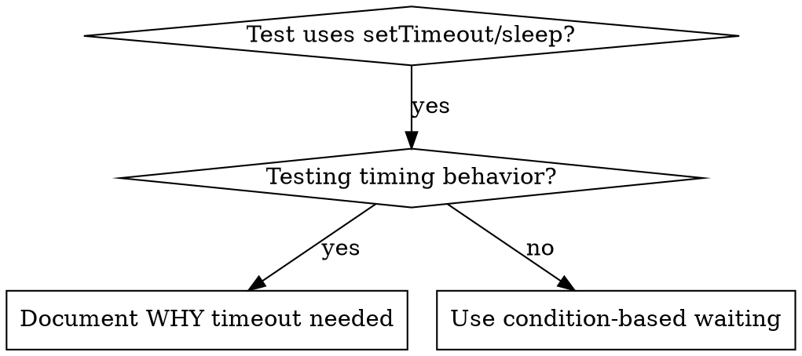

> **中文汉化版** · 上游：[obra/superpowers](https://github.com/obra/superpowers) · 原文件：`skills/systematic-debugging/condition-based-waiting.md` · License: MIT
> 翻译日期：2026-10-25 · 同步状态：上游 HEAD（2026-10-25 快照）· AI 辅助翻译 + 人工校对
> 术语以 [GLOSSARY.md](../../../../GLOSSARY.md) 为准；代码块、命令与 frontmatter 字段名保持原文。本文件为翻译作品，非上游官方中文版。

# 基于条件的等待

## 概述

不稳定的测试（flaky tests）常常用随手定的延迟去猜时序。这会制造竞态条件：测试在快的机器上通过，在高负载下或 CI 里却失败。

**核心原则：** 等你真正关心的那个条件，而不是猜它要花多久。

## 何时使用



**适用情况：**
- 测试里有随意的延迟（`setTimeout`、`sleep`、`time.sleep()`）
- 测试不稳定（时过时不过，高负载下失败）
- 测试并行运行时超时
- 等待异步操作完成

**不适用情况：**
- 测试真实的时序行为（防抖、节流间隔）
- 如果一定要用随意的超时，务必写明原因

## 核心模式

```typescript
// ❌ BEFORE: Guessing at timing
await new Promise(r => setTimeout(r, 50));
const result = getResult();
expect(result).toBeDefined();

// ✅ AFTER: Waiting for condition
await waitFor(() => getResult() !== undefined);
const result = getResult();
expect(result).toBeDefined();
```

## 快速模式

| 场景 | 模式 |
|----------|---------|
| 等待事件 | `waitFor(() => events.find(e => e.type === 'DONE'))` |
| 等待状态 | `waitFor(() => machine.state === 'ready')` |
| 等待数量 | `waitFor(() => items.length >= 5)` |
| 等待文件 | `waitFor(() => fs.existsSync(path))` |
| 复杂条件 | `waitFor(() => obj.ready && obj.value > 10)` |

## 实现

通用的轮询函数：
```typescript
async function waitFor<T>(
  condition: () => T | undefined | null | false,
  description: string,
  timeoutMs = 5000
): Promise<T> {
  const startTime = Date.now();

  while (true) {
    const result = condition();
    if (result) return result;

    if (Date.now() - startTime > timeoutMs) {
      throw new Error(`Timeout waiting for ${description} after ${timeoutMs}ms`);
    }

    await new Promise(r => setTimeout(r, 10)); // Poll every 10ms
  }
}
```

完整实现见本目录下的 `condition-based-waiting-example.ts`，包含来自实际调试会话的场景专用辅助函数（`waitForEvent`、`waitForEventCount`、`waitForEventMatch`）。

## 常见错误

**❌ 轮询太快：** `setTimeout(check, 1)` - 浪费 CPU
**✅ 修正：** 每 10ms 轮询一次

**❌ 没有超时：** 条件永远不满足就死循环
**✅ 修正：** 永远带上超时和清晰的报错

**❌ 过期数据：** 在循环之前缓存状态
**✅ 修正：** 在循环内调用 getter，拿到新鲜数据

## 什么时候随意的超时才是对的

```typescript
// Tool ticks every 100ms - need 2 ticks to verify partial output
await waitForEvent(manager, 'TOOL_STARTED'); // First: wait for condition
await new Promise(r => setTimeout(r, 200));   // Then: wait for timed behavior
// 200ms = 2 ticks at 100ms intervals - documented and justified
```

**要求：**
1. 先等到触发条件出现
2. 基于已知的时序（不是猜的）
3. 注释里说明为什么

## 实战效果

来自一次调试会话（2025-10-03）：
- 修好了 3 个文件里的 15 个不稳定测试
- 通过率：60% → 100%
- 执行时间快了 40%
- 不再有竞态条件
