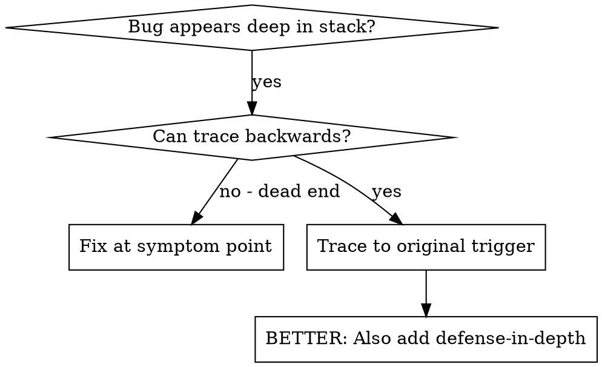
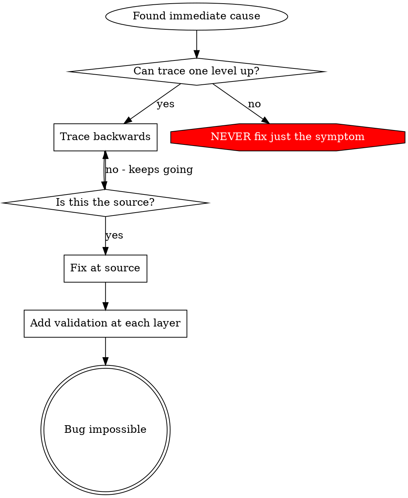

> **中文汉化版** · 上游：[obra/superpowers](https://github.com/obra/superpowers) · 原文件：`skills/systematic-debugging/root-cause-tracing.md` · License: MIT
> 翻译日期：2026-10-25 · 同步状态：上游 HEAD（2026-10-25 快照）· AI 辅助翻译 + 人工校对
> 术语以 [GLOSSARY.md](../../../../GLOSSARY.md) 为准；代码块、命令与 frontmatter 字段名保持原文。本文件为翻译作品，非上游官方中文版。

# 根因回溯

## 概述

bug 常常在调用栈深处才暴露出来（git init 跑错了目录、文件建错了位置、数据库用了错误的路径打开）。你的直觉是在报错出现的地方修，但那只是在治症状。

**核心原则：** 沿调用链向回追踪，直到找到最初的触发点，然后在源头修复。

## 何时使用



**适用情况：**
- 错误发生在执行深处（不在入口点）
- 堆栈跟踪显示很长的调用链
- 不清楚无效数据从哪里产生
- 需要找出是哪个测试/哪段代码触发了问题

## 追踪过程

### 1. 观察症状
```
Error: git init failed in ~/project/packages/core
```

### 2. 找到直接原因
**是哪段代码直接造成的？**
```typescript
await execFileAsync('git', ['init'], { cwd: projectDir });
```

### 3. 追问：谁调用了它？
```typescript
WorktreeManager.createSessionWorktree(projectDir, sessionId)
  → called by Session.initializeWorkspace()
  → called by Session.create()
  → called by test at Project.create()
```

### 4. 继续向上追踪
**传入的值是什么？**
- `projectDir = ''`（空字符串！）
- 空字符串作为 `cwd` 会解析成 `process.cwd()`
- 那可是源代码目录！

### 5. 找到最初的触发点
**空字符串是从哪来的？**
```typescript
const context = setupCoreTest(); // Returns { tempDir: '' }
Project.create('name', context.tempDir); // Accessed before beforeEach!
```

## 添加堆栈跟踪

手动追不动的时候，就加诊断埋点：

```typescript
// Before the problematic operation
async function gitInit(directory: string) {
  const stack = new Error().stack;
  console.error('DEBUG git init:', {
    directory,
    cwd: process.cwd(),
    nodeEnv: process.env.NODE_ENV,
    stack,
  });

  await execFileAsync('git', ['init'], { cwd: directory });
}
```

**关键：** 测试里要用 `console.error()`（别用 logger，logger 可能不显示）

**运行并捕获：**
```bash
npm test 2>&1 | grep 'DEBUG git init'
```

**分析堆栈跟踪：**
- 找测试文件名
- 找到触发调用的行号
- 识别规律（同一个测试？同一个参数？）

## 找出是哪个测试造成了污染

某个东西在测试过程中冒出来了，但你不知道是哪个测试干的：

用本目录下的二分定位脚本 `find-polluter.sh`：

```bash
bash ./find-polluter.sh '.git' 'src/**/*.test.ts'
```

逐个运行测试，在第一个污染者处停下。用法见脚本本身。

## 真实案例：空的 projectDir

**症状：** `.git` 被建在了 `packages/core/`（源代码目录）里

**追踪链：**
1. `git init` 运行在 `process.cwd()` ← cwd 参数是空的
2. WorktreeManager 收到了空的 projectDir
3. Session.create() 传了空字符串
4. 测试在 beforeEach 之前就访问了 `context.tempDir`
5. setupCoreTest() 初始返回 `{ tempDir: '' }`

**根因：** 顶层变量初始化时访问到了空值

**修复：** 把 tempDir 改成 getter，在 beforeEach 之前被访问就抛错

**同时加上了纵深防御：**
- 第 1 层：Project.create() 校验目录
- 第 2 层：WorkspaceManager 校验非空
- 第 3 层：NODE_ENV 守卫拒绝在 tmpdir 之外执行 git init
- 第 4 层：git init 之前记录堆栈跟踪日志

## 关键原则



**永远不要只修报错出现的地方。** 向回追踪，找到最初的触发点。

## 堆栈跟踪技巧

**在测试里：** 用 `console.error()` 而不是 logger，logger 可能被抑制
**在操作之前：** 在危险操作发生之前打日志，而不是等它失败之后
**带上上下文：** 目录、cwd、环境变量、时间戳
**捕获堆栈：** `new Error().stack` 显示完整调用链

## 实战效果

来自一次调试会话（2025-10-03）：
- 通过 5 层追踪找到了根因
- 在源头修复（getter 校验）
- 加了 4 层防御
- 1847 个测试全部通过，零污染
