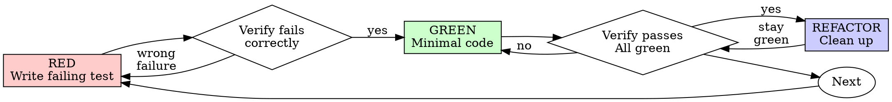

> **中文汉化版** · 上游：[obra/superpowers](https://github.com/obra/superpowers) · 原文件：`skills/test-driven-development/SKILL.md` · License: MIT
> 翻译日期：2026-10-24 · 同步状态：上游 HEAD（2026-10-24 快照）· AI 辅助翻译 + 人工校对
> 术语以 [GLOSSARY.md](../../../../GLOSSARY.md) 为准；代码块、命令与 frontmatter 字段名保持原文。本文件为翻译作品，非上游官方中文版。

# 测试驱动开发（TDD）

## 概述

先写测试。亲眼看它失败。再写最少的代码让它通过。

**核心原则：** 如果你没有亲眼看测试失败过，你就不知道它测试的是不是对的东西。

**违反规则的字面，就是违反规则的精神。**

## 何时使用

**始终适用：**
- 新功能
- bug 修复
- 重构
- 行为变更

**例外（请询问你的人类伙伴）：**
- 一次性原型
- 生成的代码
- 配置文件

想着"就这一次跳过 TDD"？停下。这是自我合理化。

## 铁律

```
NO PRODUCTION CODE WITHOUT A FAILING TEST FIRST
```

先写了代码再写测试？把代码删掉。从头再来。

**没有任何例外：**
- 不要把它留作"参考"
- 不要在写测试时"改编"它
- 不要去看它
- 删除就是删除

从测试出发全新实现。就这么简单。

## 红-绿-重构



### 红（RED）——编写失败的测试

编写一个最小化的测试，展示应该发生什么。

<Good>
```typescript
test('retries failed operations 3 times', async () => {
  let attempts = 0;
  const operation = () => {
    attempts++;
    if (attempts < 3) throw new Error('fail');
    return 'success';
  };

  const result = await retryOperation(operation);

  expect(result).toBe('success');
  expect(attempts).toBe(3);
});
```
命名清晰，测试真实行为，只测一件事
</Good>

<Bad>
```typescript
test('retry works', async () => {
  const mock = jest.fn()
    .mockRejectedValueOnce(new Error())
    .mockRejectedValueOnce(new Error())
    .mockResolvedValueOnce('success');
  await retryOperation(mock);
  expect(mock).toHaveBeenCalledTimes(3);
});
```
命名含糊，测的是 mock 而不是代码
</Bad>

**要求：**
- 只测一个行为
- 命名清晰
- 使用真实代码（除非不得已才用 mock）

### 验证红（RED）——亲眼看它失败

**强制要求。绝不可跳过。**

```bash
npm test path/to/test.test.ts
```

确认：
- 测试失败（而不是报错）
- 失败信息符合预期
- 失败的原因是功能缺失（而不是拼写错误）

**测试通过了？** 你测的是已有行为。修改测试。

**测试报错了？** 修复错误，重新运行，直到它正确地失败。

### 绿（GREEN）——编写最小代码

编写最简单的代码让测试通过。

<Good>
```typescript
async function retryOperation<T>(fn: () => Promise<T>): Promise<T> {
  for (let i = 0; i < 3; i++) {
    try {
      return await fn();
    } catch (e) {
      if (i === 2) throw e;
    }
  }
  throw new Error('unreachable');
}
```
刚好够让测试通过
</Good>

<Bad>
```typescript
async function retryOperation<T>(
  fn: () => Promise<T>,
  options?: {
    maxRetries?: number;
    backoff?: 'linear' | 'exponential';
    onRetry?: (attempt: number) => void;
  }
): Promise<T> {
  // YAGNI
}
```
过度设计
</Bad>

不要添加功能，不要重构其他代码，不要"改进"超出测试要求的范围。

### 验证绿（GREEN）——亲眼看它通过

**强制要求。**

```bash
npm test path/to/test.test.ts
```

确认：
- 测试通过
- 其他测试依然通过
- 输出干净（没有错误、没有警告）

**测试失败了？** 修代码，而不是改测试。

**其他测试失败了？** 立即修复。

**"其他测试"指的是整个项目的测试套件，而不只是你的那个文件。** 你
自己写的那个测试通过，不代表整个套件通过。在你宣布改动完成之前，
先运行项目级的测试命令（裸的 `pytest`、`npm test`、`cargo test`——
用这个仓库实际用的那一个），即使你的任务只点名了一个测试文件。任
务描述中的范围限定的是交付物，不是你的验证范围。那轮运行暴露出的
任何失败——包括不是你造成的失败——都必须在报告中点名列出；一个你
眼看着它刷过却只字未提的红色测试，就是一次通过隐瞒造成的虚假报告。

### 重构（REFACTOR）——清理代码

只在变绿之后：
- 消除重复
- 改进命名
- 提取辅助函数

保持测试绿色。不要添加行为。

### 重复循环

为下一个功能编写下一个失败的测试。

## 好测试

| 质量属性 | 好 | 差 |
|---------|------|-----|
| **最小** | 只测一件事。名字里有"和"？拆开。 | `test('validates email and domain and whitespace')` |
| **清晰** | 名字描述行为 | `test('test1')` |
| **展示意图** | 演示期望的 API | 让人看不出代码应该做什么 |

在编写或修改任何测试时，阅读 [writing-good-tests.md](writing-good-tests.md)，遵循这些让测试保持诚实的规则：
- 在编写测试之前，先说出会让这个测试失败的那个生产代码改动是什么
- 断言真实行为，绝不断言 mock 行为
- 仅测试用的代码放进测试工具类，不要混进生产类
- 在 mock 一个依赖之前，先理解它的副作用

## 常见的自我合理化

| 借口 | 现实 |
|--------|---------|
| "太简单了不用测" | 简单的代码也会出 bug。写测试只要 30 秒。 |
| "我以后再补测试" | 事后写的测试一跑就通过——而这什么也证明不了。它可能测错了对象、测的是实现而不是行为，或者漏掉了你忘记的那个边界情况。你从未看过它失败，所以你从未证明它能抓住 bug。测试先行恰恰强制了这个失败环节。 |
| "事后测试同样能达到目的（重要的是精神而非仪式）" | 事后测试回答的是"这段代码做了什么？"；测试先行回答的是"这段代码应该做什么？"事后写的测试会被你已经写出的代码带偏——你验证的是你记得住的那些用例，而不是你本可以发现的问题。覆盖率有了，却没有证据表明测试本身有效。 |
| "我已经手动测过了" | 手动测试是临时性的：没有覆盖记录，代码一改无法重放，压力大时容易漏用例。"我试过没问题"≠全面。自动化测试每次都以同样的方式运行。 |
| "删掉花了几小时的代码太浪费了" | 沉没成本谬误——那些时间无论如何都已经花掉了。真正的选择是：用 TDD 重写（高置信度）vs. 保留代码再补测试（低置信度，大概率有 bug）。留着你不信任的代码才是真正的浪费。 |
| "留作参考，测试还是先写" | 你一定会去改编它。那就是事后测试。删除就是删除。 |
| "我需要先探索一下" | 可以。探索完就扔掉，从 TDD 重新开始。 |
| "测试难写 = 设计不清晰" | 听测试的话。难测试 = 难使用。 |
| "TDD 会拖慢我" | TDD 本身就是务实之路：在提交前抓住 bug，防止回归，让你可以毫无恐惧地重构。走"务实"的捷径意味着在生产环境中调试——更慢，而不是更快。 |
| "手动测试更快" | 手动测试证明不了边界情况。你以后每次改动都得重测一遍。 |
| "现有代码没有测试" | 你正在改进它。为现有代码补上测试。 |

## 红色信号——停下，从头再来

- 先写代码后写测试
- 实现完才写测试
- 测试立即就通过
- 说不清测试为什么失败
- "以后"再补的测试
- 为"就这一次"找理由
- "我已经手动测过了"
- "事后测试同样能达到目的"
- "重要的是精神不是仪式"
- "留作参考"或"改编现有代码"
- "已经花了几小时了，删了太浪费"
- "TDD 太教条，我这是务实"
- "这次情况不一样，因为……"

**以上任何一条都意味着：删除代码。从 TDD 重新开始。**

## 示例：bug 修复

**Bug:** 空邮箱被接受

**RED**
```typescript
test('rejects empty email', async () => {
  const result = await submitForm({ email: '' });
  expect(result.error).toBe('Email required');
});
```

**Verify RED**
```bash
$ npm test
FAIL: expected 'Email required', got undefined
```

**GREEN**
```typescript
function submitForm(data: FormData) {
  if (!data.email?.trim()) {
    return { error: 'Email required' };
  }
  // ...
}
```

**Verify GREEN**
```bash
$ npm test
PASS
```

**REFACTOR**
如有需要，把校验逻辑提取出来供多个字段复用。

## 验证清单

在标记工作完成之前：

- [ ] 每个新函数/方法都有测试
- [ ] 在实现之前亲眼看每个测试失败过
- [ ] 每个测试都因预期原因失败（功能缺失，而不是拼写错误）
- [ ] 为每个测试编写了最小实现使其通过
- [ ] 所有测试通过
- [ ] 输出干净（没有错误、没有警告）
- [ ] 测试使用真实代码（仅在不得已时使用 mock）
- [ ] 覆盖了边界情况和错误情况

没法全部勾上？说明你跳过了 TDD。从头再来。

## 卡住时

| 问题 | 解决办法 |
|---------|----------|
| 不知道怎么测 | 写出你期望中的 API。先写断言。问你的人类伙伴。 |
| 测试太复杂 | 说明设计太复杂。简化接口。 |
| 什么都得 mock | 代码耦合太紧。使用依赖注入。 |
| 测试准备代码巨大 | 提取辅助函数。还是复杂？简化设计。 |

## 与调试的衔接

发现了 bug？编写一个能复现它的失败测试，然后走 TDD 循环。测试既证明修复有效，又防止回归。

绝不在没有测试的情况下修 bug。

## 最终规则

```
Production code → test exists and failed first
Otherwise → not TDD
```

未经你的人类伙伴许可，没有任何例外。
