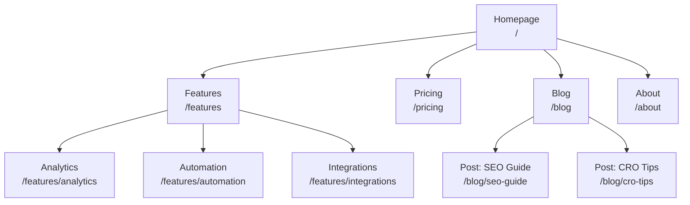
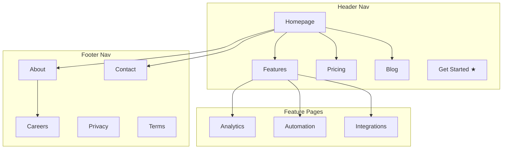
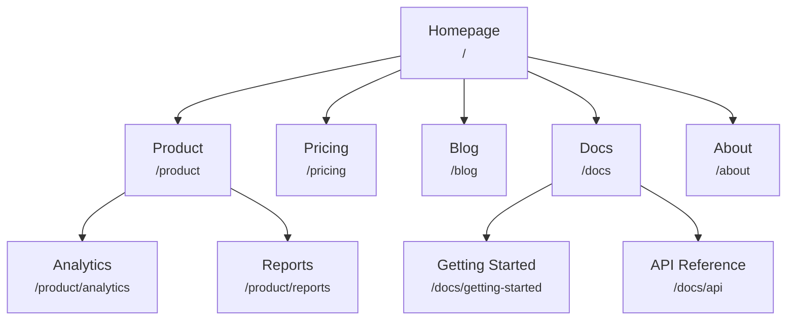
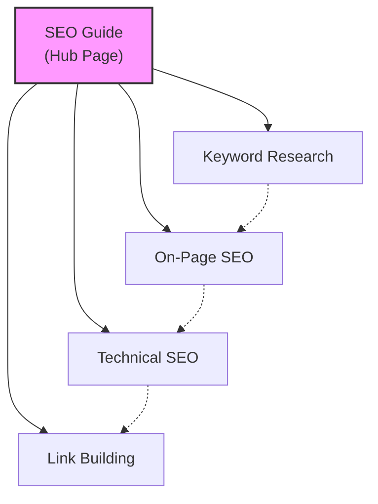
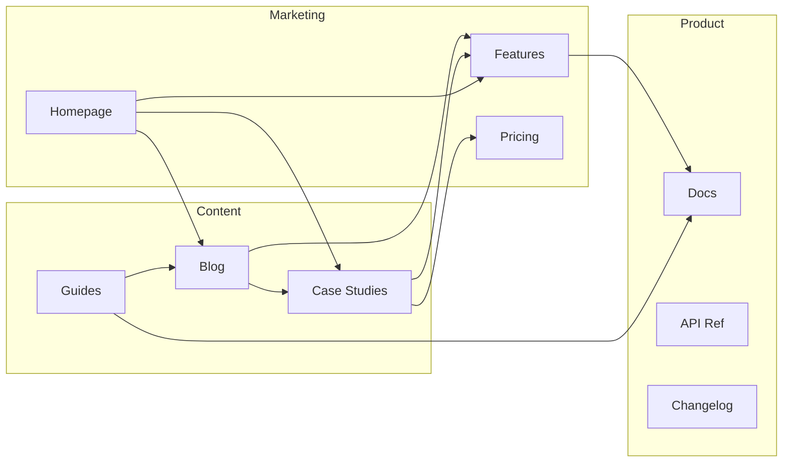
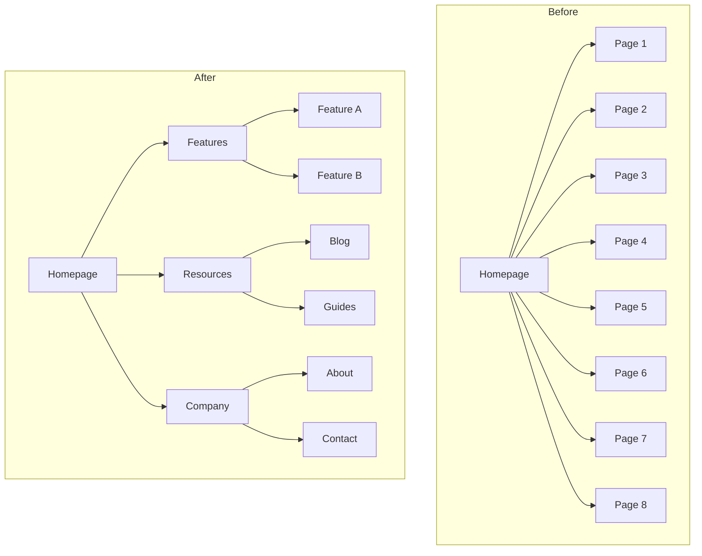
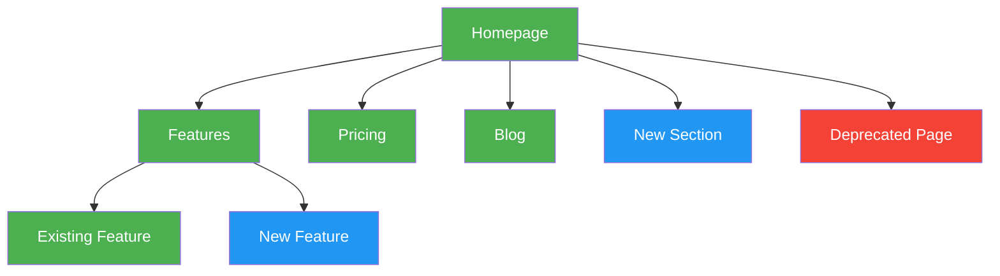

> **中文汉化版** · 上游：[coreyhaines31/marketingskills](https://github.com/coreyhaines31/marketingskills) · 原文件：`skills/growth/product/site-architecture/references/mermaid-templates.md` · License: MIT
> 翻译日期：2026-11-15 · 同步状态：上游 HEAD（2026-11-15 快照）· AI 辅助翻译 + 人工校对
> 术语以 [GLOSSARY.md](../../../../../GLOSSARY.md) 为准；代码块、命令与 frontmatter 字段名保持原文。本文件为翻译作品，非上游官方中文版。

# Mermaid 图表模板

可直接复制使用的 Mermaid 图，用来画可视化站点地图。按你的站点改节点标签和连线。

---

## 基础层级

简单的自上而下页面层级。

---

## 带导航分区的层级

用子图展示各页面出现在哪个导航区。

---

## 带 URL 标签的层级

每个节点同时显示页面名和 URL 路径。

---

## 中心-辐条内容模型

展示中心页连接多篇辐条文章，辐条之间也互相链接。

图例：
- 实线 = 中心页到辐条页的主链接
- 虚线 = 辐条页之间的交叉链接

---

## 内链流向

展示站点各板块之间如何互相链接。

---

## 重构前后对比

并列对比现状与拟议的站点结构。

---

## 配色约定

用样式突出页面状态、优先级或类型。

颜色说明：
- **绿色** (`#4CAF50`)：现有页面（无改动）
- **蓝色** (`#2196F3`)：待新建页面
- **红色** (`#f44336`)：待删除或重定向的页面
- **黄色** (`#FFC107`)：待重构或迁移的页面
- **紫色** (`#9C27B0`)：高优先级 / CTA 页面
