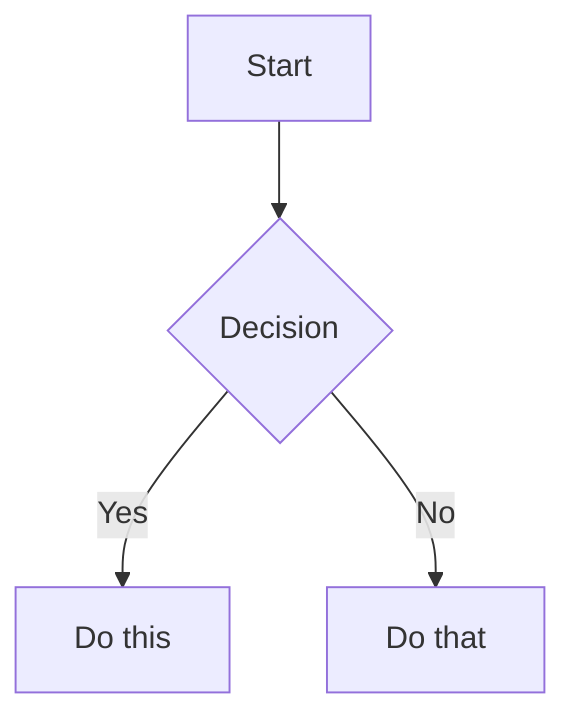

> **中文汉化版** · 上游：[kepano/obsidian-skills](https://github.com/kepano/obsidian-skills) · 原文件：`skills/obsidian-markdown/SKILL.md` · License: MIT
> 翻译日期：2026-11-03 · 同步状态：上游 HEAD（2026-11-03 快照）· AI 辅助翻译 + 人工校对
> 术语以 [GLOSSARY.md](../../../../GLOSSARY.md) 为准；代码块、命令与 frontmatter 字段名保持原文。本文件为翻译作品，非上游官方中文版。

# Obsidian Flavored Markdown Skill

创建和编辑合法的 Obsidian Flavored Markdown。Obsidian 在 CommonMark 和 GFM 之上扩展了 wikilink、embed、callout、property、注释等语法。本 Skill 只覆盖 Obsidian 特有的扩展 —— 标准 Markdown（标题、粗体、斜体、列表、引用、代码块、表格）属于默认已知内容。

## 工作流：创建 Obsidian 笔记

1. **添加 frontmatter**：在文件顶部写入 property（title、tags、aliases）。所有 property 类型见 [PROPERTIES.md](references/PROPERTIES.md)。
2. **编写内容**：结构使用标准 Markdown，再加上文所述的 Obsidian 特有语法。
3. **关联相关笔记**：vault 内部连接使用 wikilink（`[[Note]]`），外部 URL 使用标准 Markdown 链接。
4. **嵌入内容**：使用 `![[embed]]` 语法嵌入其他笔记、图片或 PDF。所有 embed 类型见 [EMBEDS.md](references/EMBEDS.md)。
5. **添加 callout（标注块）**：使用 `> [!type]` 语法突出显示信息。所有 callout 类型见 [CALLOUTS.md](references/CALLOUTS.md)。
6. **验证**：确认笔记在 Obsidian 阅读视图中正确渲染。

> 在 wikilink 与 Markdown 链接之间选择时：vault 内笔记使用 `[[wikilinks]]`（Obsidian 会自动跟踪重命名），`[text](url)` 仅用于外部 URL。

## 内部链接（Wikilinks）

```markdown
[[Note Name]]                          Link to note
[[Note Name|Display Text]]             Custom display text
[[Note Name#Heading]]                  Link to heading
[[Note Name#^block-id]]                Link to block
[[#Heading in same note]]              Same-note heading link
```

在任意段落末尾追加 `^block-id` 即可定义块 ID：

```markdown
This paragraph can be linked to. ^my-block-id
```

对于列表和引用，将块 ID 放在块之后的单独一行：

```markdown
> A quote block

^quote-id
```

## 嵌入（Embeds）

在任意 wikilink 前加 `!` 即可将其内容内联嵌入：

```markdown
![[Note Name]]                         Embed full note
![[Note Name#Heading]]                 Embed section
![[image.png]]                         Embed image
![[image.png|300]]                     Embed image with width
![[document.pdf#page=3]]               Embed PDF page
```

音频、视频、搜索嵌入和外部图片见 [EMBEDS.md](references/EMBEDS.md)。

## Callout（标注块）

```markdown
> [!note]
> Basic callout.

> [!warning] Custom Title
> Callout with a custom title.

> [!faq]- Collapsed by default
> Foldable callout (- collapsed, + expanded).
```

常见类型：`note`、`tip`、`warning`、`info`、`example`、`quote`、`bug`、`danger`、`success`、`failure`、`question`、`abstract`、`todo`。

完整列表（含别名、嵌套和自定义 CSS callout）见 [CALLOUTS.md](references/CALLOUTS.md)。

## 属性（Property，即 frontmatter）

```yaml
---
title: My Note
date: 2024-01-15
tags:
  - project
  - active
aliases:
  - Alternative Name
cssclasses:
  - custom-class
---
```

默认 property：`tags`（可搜索的标签）、`aliases`（备选笔记名，用于链接建议）、`cssclasses`（用于样式的 CSS 类）。

所有 property 类型、tag 语法规则和高级用法见 [PROPERTIES.md](references/PROPERTIES.md)。

## 标签（Tags）

```markdown
#tag                    Inline tag
#nested/tag             Nested tag with hierarchy
```

tag 可包含字母、数字（不能作为首字符）、下划线、连字符和正斜杠。tag 也可以在 frontmatter 的 `tags` property 中定义。

## 注释

```markdown
This is visible %%but this is hidden%% text.

%%
This entire block is hidden in reading view.
%%
```

## Obsidian 特有格式化

```markdown
==Highlighted text==                   Highlight syntax
```

## 数学（LaTeX）

```markdown
Inline: $e^{i\pi} + 1 = 0$

Block:
$$
\frac{a}{b} = c
$$
```

## 图表（Mermaid）

````markdown

````

要将 Mermaid 节点链接到 Obsidian 笔记，添加 `class NodeName internal-link;`。

## 脚注

```markdown
Text with a footnote[^1].

[^1]: Footnote content.

Inline footnote.^[This is inline.]
```

## 完整示例

````markdown
---
title: Project Alpha
date: 2024-01-15
tags:
  - project
  - active
status: in-progress
---

# Project Alpha

This project aims to [[improve workflow]] using modern techniques.

> [!important] Key Deadline
> The first milestone is due on ==January 30th==.

## Tasks

- [x] Initial planning
- [ ] Development phase
  - [ ] Backend implementation
  - [ ] Frontend design

## Notes

The algorithm uses $O(n \log n)$ sorting. See [[Algorithm Notes#Sorting]] for details.

![[Architecture Diagram.png|600]]

Reviewed in [[Meeting Notes 2024-01-10#Decisions]].
````

## 参考资料

- [Obsidian Flavored Markdown](https://help.obsidian.md/obsidian-flavored-markdown)
- [内部链接](https://help.obsidian.md/links)
- [嵌入文件](https://help.obsidian.md/embeds)
- [Callout（标注块）](https://help.obsidian.md/callouts)
- [属性（Property）](https://help.obsidian.md/properties)
